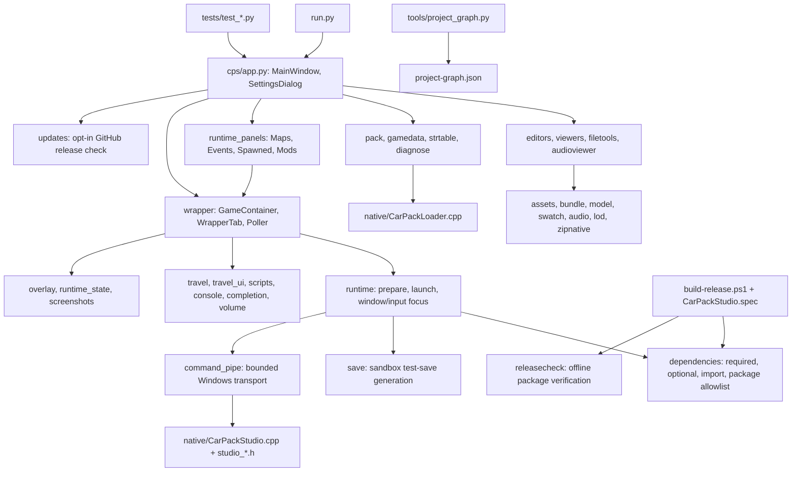

# AI navigation graph

[project-graph.json](project-graph.json) is a local, machine-readable index of every authored source/test/build/documentation node and Python class/function, with file hashes and exact line locations.
It contains no source excerpts, private runtime data or telemetry. Nothing is sent to an AI service.
Binary resources are deliberately excluded; native functions remain indexed by their source-file nodes.
Imports/includes are static evidence, not proof of runtime calls.

Regenerate after source changes: `python tools\project_graph.py`.
Check freshness: `python tools\project_graph.py --check`.
Query `nodes` by `id`, `path`, `name` or `kind`; follow `edges` of kind `imports`, `includes` and `contains`.
Read the relevant source after locating it: the graph does not replace execution evidence.

